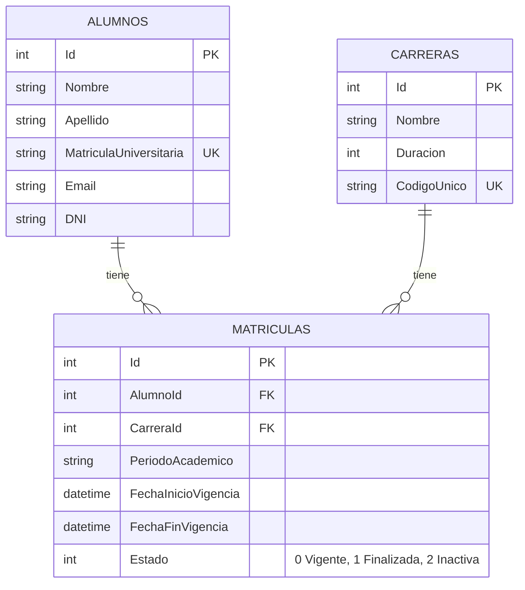
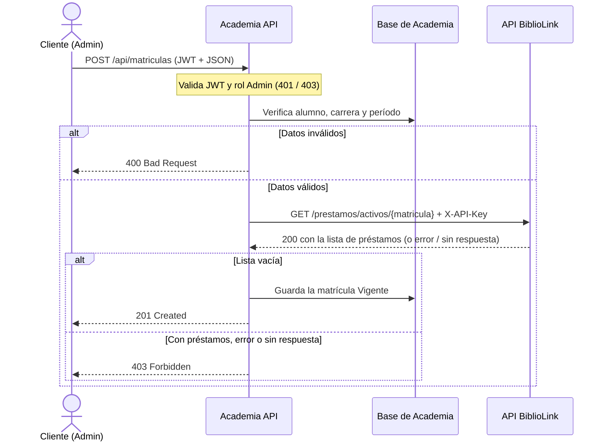

# Academia Central API

API REST de Academia Central para consultar y administrar alumnos, carreras, matrículas y la integración con BiblioLink. Usa ASP.NET Core, SQLite y JWT para proteger las operaciones administrativas.

## Requisitos

- .NET SDK 10
- Entity Framework Core CLI (`dotnet tool install --global dotnet-ef`, si aún no está instalado)

## Configuración y ejecución

Configura la clave de firma JWT y las credenciales temporales del primer administrador con User Secrets. Usa una clave aleatoria de al menos 32 bytes y una contraseña segura:

```powershell
dotnet user-secrets set "Jwt:Key" "<clave-aleatoria-de-al-menos-32-bytes>"
dotnet user-secrets set "BiblioLink:ApiKey" "<clave-que-BiblioLink-envia-a-Academia>"
dotnet user-secrets set "BiblioLink:OutboundApiKey" "<clave-que-Academia-envia-a-BiblioLink>"
dotnet user-secrets set "BootstrapAdmin:NombreUsuario" "admin"
dotnet user-secrets set "BootstrapAdmin:Contrasena" "<contraseña-segura>"
```

La aplicación crea ese Admin al iniciar solamente cuando la tabla de usuarios está vacía. Después del primer inicio, las claves `BootstrapAdmin` se pueden quitar; `Jwt:Key`, `BiblioLink:ApiKey` y `BiblioLink:OutboundApiKey` deben permanecer configuradas. Son claves independientes: `BiblioLink:ApiKey` es la que BiblioLink debe enviar a Academia, mientras que `BiblioLink:OutboundApiKey` es la que Academia envía a BiblioLink. Configura los valores reales en User Secrets, no en `appsettings.json`, y no los registres en logs.

Aplica las migraciones y ejecuta la API:

```powershell
dotnet ef database update
dotnet run --launch-profile http
```

La documentación interactiva de Swagger está disponible en [http://localhost:5111/swagger](http://localhost:5111/swagger).

## Autenticación

Inicia sesión con `POST /api/auth/login`:

```json
{
  "nombreUsuario": "admin",
  "contrasena": "<contraseña>"
}
```

La respuesta contiene un token JWT. En Swagger, pulsa **Authorize**, pega el token y úsalo para las operaciones que lo requieren. También puedes enviarlo desde otro cliente HTTP como `Authorization: Bearer <token>`.

Solo Admin puede crear usuarios con `POST /api/auth/usuarios`. Ejemplo de cuerpo:

```json
{
  "nombreUsuario": "alumno1",
  "contrasena": "<contraseña-de-al-menos-8-caracteres>",
  "rol": "Alumno",
  "alumnoId": 9001
}
```

`alumnoId` es opcional; si se proporciona, debe corresponder a un alumno existente. Las contraseñas se almacenan como hashes y no se devuelven en las respuestas.

## Acceso por rol

- Los endpoints de alumnos y carreras requieren autenticación. Admin puede listar y modificar; Alumno solo puede consultar su propio alumno y sus matrículas.
- Los cambios de matrículas (`POST`, `PUT`, `DELETE`) requieren Admin.
- `GET /api/alumnos/{id}/loans` está disponible para Admin y Personal; Personal solo puede consultar préstamos.
- Para comprobarlo en Swagger, inicia sesión como Admin, copia el token en **Authorize** y crea un usuario Alumno asociado a un alumno existente. Luego inicia sesión con ese Alumno y verifica que `GET /api/alumnos/{id}` y `GET /api/matriculas` solo permitan consultar sus propios datos. Sin token, las rutas protegidas responden `401`; con rol insuficiente, `403`.
- Si la biblioteca rechaza una matrícula por préstamos pendientes, la API conserva la respuesta `403`.

## Rutas principales

- `/api/auth`: inicio de sesión y administración de usuarios.
- `/api/alumnos`: consulta y gestión de alumnos; incluye la validación de estado y el proxy de préstamos.
- `/api/carreras`: consulta y gestión de carreras.
- `/api/matriculas`: consulta y gestión de matrículas.

## Integración con BiblioLink

En desarrollo local, Academia Central usa `http://localhost:5111/api` y BiblioLink usa `http://localhost:5245/api`. Academia obtiene la URL base de BiblioLink del campo `UrlBase` en `ConfiguracionesApiBiblioteca`.


- **BiblioLink consulta a Academia:** `GET /api/alumnos/{matricula}/estado`. No requiere JWT; requiere `X-API-Key` con el valor configurado en `BiblioLink:ApiKey`. Responde `200` con `{ "matricula": "A1001", "esActivo": true }` (o `false`), `404` con `{ "mensaje": "Matrícula no encontrada" }` si la matrícula no existe y `401` si falta la clave o no coincide.
- **Academia consulta a BiblioLink:** `GET {UrlBase}/prestamos/activos/{matricula}`. Academia envía `X-API-Key` con `BiblioLink:OutboundApiKey`. BiblioLink debe responder `200` con una lista de préstamos (`prestamoId`, `libroTitulo`, `estado`); si no hay préstamos, la lista es `[]`. Una lista con préstamos, una respuesta no exitosa o un fallo de comunicación impiden crear la matrícula y producen `403`.
- **Consulta de préstamos desde Academia:** `GET /api/alumnos/{id}/loans` requiere JWT y está disponible para los roles Admin y Personal. Personal puede consultar préstamos, pero no realizar operaciones administrativas.

- ## Modelo de datos: Alumnos, Carreras y Matrículas

Alumnos y Carreras se relacionan de muchos a muchos, y la tabla `Matriculas` resuelve esa relación: cada fila une un alumno con una carrera en un período académico.



`PK` es clave primaria, `FK` clave foránea y `UK` valor único.

| Aspecto | Detalle |
|---|---|
| Índices únicos | `Alumnos.MatriculaUniversitaria` y `Carreras.CodigoUnico` no se pueden repetir. |
| Borrado en cascada | Al eliminar un alumno o una carrera se eliminan sus matrículas. |
| `Estado` | Se guarda como entero: `Vigente = 0`, `Finalizada = 1`, `Inactiva = 2`. |
| Regla de negocio | Una sola matrícula `Vigente` por alumno y período. La valida `MatriculaDbService`, no la base de datos. |

## Endpoint de creación de matrícula: `POST /api/matriculas`

### Solicitud

- **Acceso:** JWT con rol `Admin` (`Authorization: Bearer <token>`).
- **Cuerpo** (`MatriculaCreateDTO`):

  ```json
  {
    "alumnoId": 9001,
    "carreraId": 9001,
    "periodoAcademico": "2027-1"
  }
  ```

El servidor fija el resto de los datos: inicio de vigencia = ahora, fin = ahora + 6 meses y estado = `Vigente`.

### Respuestas

| Código | Cuándo ocurre | Cuerpo |
|---|---|---|
| `201 Created` | Pasó todas las validaciones y no hay préstamos pendientes. | La matrícula creada (`Location` apunta a `GET /api/matriculas/{id}`). |
| `400 Bad Request` | Alumno o carrera inexistente, o ya hay una matrícula vigente en ese período. | `{ "error": "Petición Inválida", "mensaje": "..." }` |
| `401 Unauthorized` | Falta el token, es inválido o está vencido. | Sin cuerpo. |
| `403 Forbidden` | Rol distinto de `Admin`; o BiblioLink informa préstamos pendientes, falla o no responde. | Por préstamos: `{ "error": "Acceso Denegado", "mensaje": "Debe devolver los libros pendientes o en mora antes de matricularse." }` |

### Flujo de validación externa con BiblioLink

Primero se valida el token y el rol, luego los datos locales. Solo si todo es correcto Academia consulta a BiblioLink con su `X-API-Key`. Una lista vacía permite continuar; una lista con préstamos, un error o la falta de respuesta bloquean la matrícula con `403` (criterio *fail-closed*: ante la duda, no se matricula).


